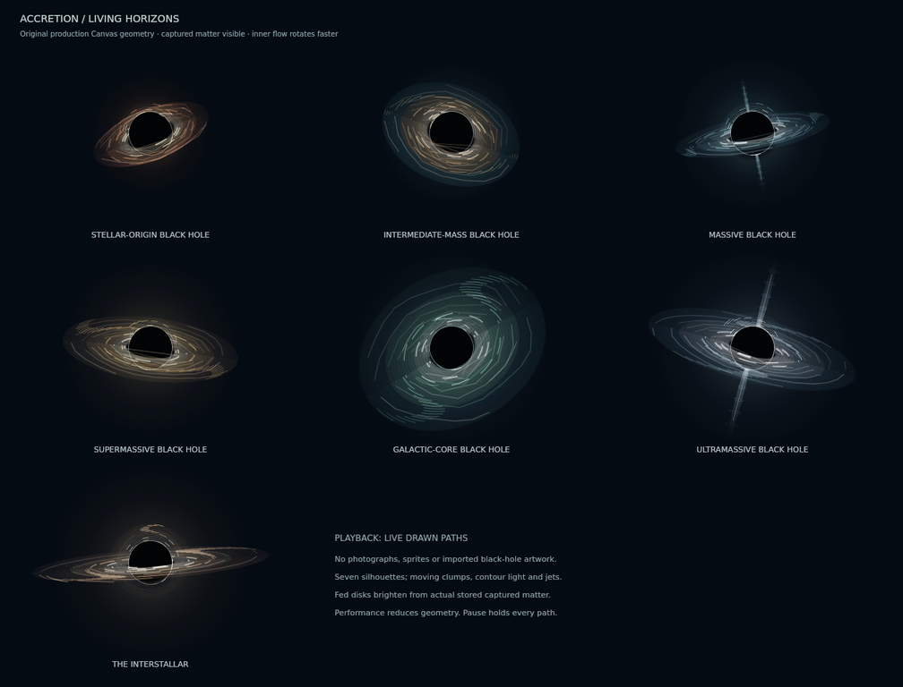
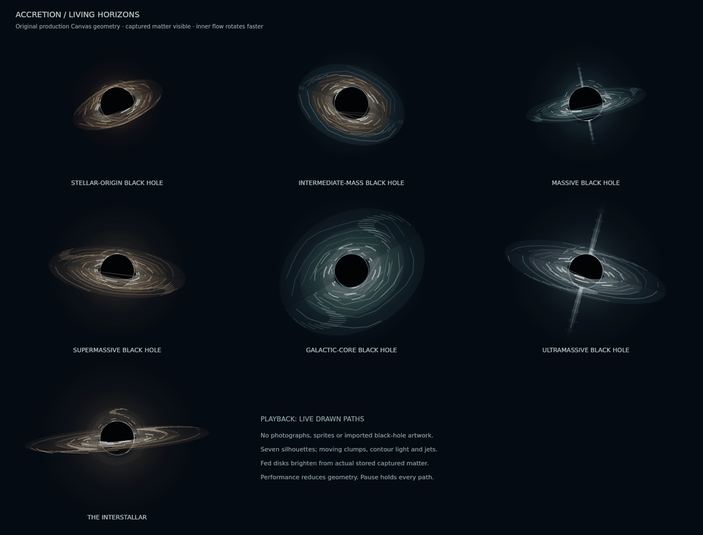

# Living horizons · ACCRETION 3.9.0

Every black-hole class uses original procedural Canvas paths. No photograph, imported black-hole asset, generated bitmap artwork or external dependency is drawn into a player or rival horizon. The seven silhouettes differ in inclination, disk thickness, flow structure and projected light; a colour change is only part of the design.

| Class | Original design | Readable motion |
| --- | --- | --- |
| Stellar-origin | Uneven amber ember lanes | Wavering disk, fast inner clumps, returning-light segments |
| Intermediate-mass | Broad, inclined copper vortex with blue outer dust | Three winding streams and a deep projected ellipse |
| Massive | Thin blue polar engine | Two feeding-driven jets with travelling knots |
| Supermassive | Wide golden torus | Four streams, dense warm inner layers, slower outer flow |
| Galactic-core | Inclined teal maelstrom | Precessing plane, broad swirling arms, moving outer light |
| Ultramassive | Pale quasar crown | Longer bipolar jets, multiple curved returning-light images |
| The Interstallar | Nearly edge-on ivory and amber disk | Individually advected bright outer filaments and fast inner contours |

The Singularity precursor retains its separate inward-curving light design. Other Supernova routes retain their original cloud, pulsar, magnetar, Strange Matter and gravastar animations. Gravastars show a hypothetical vacuum-energy interior and thin material boundary, with no event horizon.

Gas layers and jets use the owner's real captured-matter mass. Faint contours around an unfed horizon represent a stylized return of background light; they are not a gas reservoir and never add mass. Capturing, stripping and accreting material update radiance smoothly. Directional disk beaming remains optional. Jet shapes are gameplay visualizations, not a simulation of magnetic fields or a physical claim about a particular mass class.

Flow uses the existing interpolated simulation clock. Inner lanes move faster through an approximate radius-to-the-minus-three-halves relationship. Pause, Photo and Reduced Motion freeze their paths. Performance lowers lane, stream, contour and knot counts; only the player, selected body and at most two ordinary rival horizons receive rich geometry each frame. There are no new physics bodies, listeners or frame loops.

The separate Final Interstallar encounter keeps its bounded locally calculated null-ray renderer and lensing, with moving foreground gas layered over it. Those cached rays are computed from equations locally, not copied from images. Its optional WebGL path remains a distinct landmark setting.

These previews were captured from the production paths in an isolated native software Canvas. They demonstrate the shapes and phase changes; they are not screenshots of a tested browser or a measurement of device FPS. To inspect the actual production renderer offline, open `tests/body-animation.html`, choose a black-hole class and use Pause, Reduced Motion or Performance. `tests/run-all.html` includes the stage-render checks.
